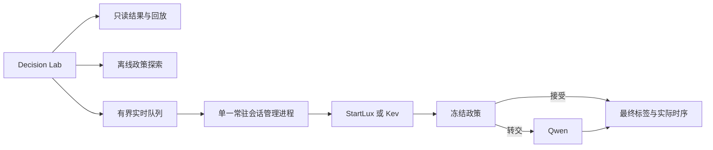

# 从已完成 v1 到研究扩展与 Decision Lab

**后续执行更新**：用户已授权执行收敛方案，现已完成独立v2本地实现、数据准备及CPU网页。
当前范围以[V2_PROTOCOL_ZH.md](V2_PROTOCOL_ZH.md)为准，GPU新增结果仍待运行。
本页下文是此前的备选分析，ANLI不是当前必做项。

日期：2026-11-02。本文是基于源码、回传证据、课程材料和一手文献的**扩展建议**；新实验、路由器、数据集及网页均尚未实现或运行。v1 已完成，不因扩展而改写其结果。

**同日后续评审**：用户提供 Claude 的更窄范围方案后，已完成[交叉复核与修订建议](CLAUDE_V2_REVIEW_ZH.md)。在其提出的紧范围/提前交付目标下，当前更倾向“旧任务补 fitting 数据 + fresh SQuAD + 小型系统对照 + CPU Lab”；下文 ANLI 主线保留为另一可选研究范围，不是已冻结或已实施的决定。

## 建议与当前定位

建议继续扩展，并把范围集中在**一个新任务上的净收益路由研究，加一个可交互的 Decision Lab**。这样新增任务与方法回答同一个研究问题，前端将其变成可操作的成果。较大后级、风险认证、稳健性和开放到达负载都是有价值的备选，但不要同时成为主线。

不到一周完成了环境恢复、三模型采集、统计分析和真实服务测量，说明基础设施已可用。后续投入应增加结论的深度、适用范围和可复现性。此前“GPU 实验完成”指预定 v1 完成，并不意味着项目不值得继续研究。

本地课程材料记载报告/GitHub 截止 12 月 15 日，距今天 43 天；presentation 和 demo 各占 30%。这给扩展与展示留有空间，但不是六周全职工时，也不是漂亮网页的得分保证。展示日期及 Courseworks 后续变动未查询。见[课程要求与交付整理](FINISH_PROJECT_ZH.md)。

## 已有结果为什么足以支持下一步

| 已核验事实 | 后续可以回答的问题 |
|---|---|
| 15,950 条正式预测，三模型、两个任务、零失败/重试 | 能否在不同任务上复现部署层面的质量/性能关系？ |
| StartLux 在 CLINC/SQuAD 为 93.50%/91.25%，Qwen 为 88.00%/86.00% | 后级并非天然更强，什么输入值得转交？ |
| StartLux→Qwen 在 SQuAD 转交 125 条，救回 29、误伤 24，仅净增 5 条 | 预测“前级是否错误”与预测“后级能否改善”有多大差别？ |
| 同一 125 条转交配额下，置信度路由 91.50%，事后 oracle 94.55% | 能否用部署时可得特征学到部分互补性？oracle 只是上界，不保证可学到。 |
| StartLux 的测试接受错误率为 6.34%/6.29%，超过验证集 5%经验目标 | 风险目标能否迁移？需要多少独立认证数据，代价是什么？ |
| 60 个 live 单元、60,200 次输入执行；SQuAD c8 级联吞吐比直接 StartLux 低 23.6% | 小幅质量收益是否值得额外系统成本？真实排队后是否仍成立？ |

证据来自[正式结果](../reports/formal-2026-11-02/RESULTS_ZH.md)和[性能报告](../reports/benchmark-2026-11-02/BENCHMARK_ZH.md)。重复请求不是新增独立质量样本；当前速度结论是固定部署的比较，不能归因为模型架构本身。

温度对照、risk–coverage、accuracy–deferral、同配额随机/oracle、配对 bootstrap、纠错/误伤和固定池 OOS 比例重加权已经做过。再次生成这些图不算新增研究贡献。

## 推荐主线：学习什么时候转交有净收益

现有 gate 主要依据前级最大概率。新问题可以明确为：

> 在相同转交预算下，利用前级输出预测转交净收益，是否优于仅按前级不确定性路由？新增质量是否值得实测的服务代价？

每个训练样本的目标为 `g = 1[Qwen正确] − 1[前级正确]`，取值 +1、0、−1。+1 表示救回，−1 表示误伤。一个正则化的低容量模型估计 `P(g=+1|z) − P(g=−1|z)`，其中 z 仅含转交前可获得的最大概率、top-2 margin、熵、前级标签、输入长度等。先用简单模型，不新增 embedding 服务或大模型训练。

训练时当然需要两模型的输出和 gold 来构造监督目标；部署时不能把 Qwen 的答案、正确性或 test gold 当路由特征，否则已经付出了后级成本或泄漏了答案。此方法允许训练小路由器，仍保持三个语言模型权重冻结；这是相对原 proposal 的明确范围扩展。

学习式路由已有相关工作，不宜把这一概念本身称为原创。本文可贡献特定 decision-model 场景下，置信度、条件互补性和真实单 GPU 成本之间的独立实证。[RouteLLM](https://arxiv.org/abs/2406.18665)使用偏好数据训练强弱模型路由，与这里基于任务正确性差的设计并非同一算法。

### 最小可执行实验矩阵

优先把 ANLI 作为唯一新增任务，在看任何模型结果前指定一个 round；例如 R1，另外两个 round 留作扩展。先用 StartLux→Qwen 为主比较，Kev 的新任务直接结果可作为有余力时补充的第三模型基线。v1 的两个任务保留为已完成背景和探索，不必同时重新开展两套 v2。

| 项目 | 建议设计 |
|---|---|
| 数据角色 | prompt/工程 development、router fitting、policy selection、新 holdout 分离；检查共享 premise/来源并分组，保留官方 train/dev/test 角色 |
| 起始规模示意 | fitting 1,000 + selection 500 + holdout 1,000；另有少量独立工程开发样本。规模需在正式协议中按精度要求确认，不承诺能检出很小的改善 |
| 模型调用 | 两模型各 2,500 条，即约 5,000 次主采集调用，另计开发/预热/性能；所有离线路由复用同一批真实预测 |
| 路由对照 | 最大概率、margin、entropy、低容量 gain router；同配额随机与 oracle 作参考；两个直接模型始终列出 |
| 主要比较 | 建议以 holdout 上精确 10% top-k 的批处理排序比较为主终点，比较 gain 与最大概率路由的配对准确率差；其余预算作次要曲线，不能看测试结果再挑主预算 |
| 诊断指标 | rescue、harm、净增益、实际转交率；分别预定与 StartLux、Qwen 的配对比较，按 premise/来源处理相关性。测试上挑出的最佳直接模型仅作描述性参照，联合推断需预定多重比较处理 |
| 真实部署 | 在 selection 上冻结在线分数阈值，只给 1–2 个预选工作点测量真实吞吐/延迟，包含 router 开销 |

**批处理排序配额与在线阈值是两种政策。** 前者能在测试工作负载中严格匹配转交数量，用于比较排序能力；后者不预知整个未来批次，部署时实际转交率可能变化。分别报告，不能把按测试批次 top-k 转交的结果直接当作固定在线 gate 的表现。本建议将在线冻结阈值作为次要部署评价，报告实际预算偏离；若后续改以在线政策为主，须在正式协议与测试开放前明确改动。

首版可使用 released 概率，减少一个方法选择维度。若重拟合温度，温度与 router 的拟合均限定在 fitting 区域，并在 selection 上选择超参数和阈值；不把共用 fitting 数据描述为彼此独立的认证。所有主比较、种子、停止条件与失败处理在 holdout 打开前冻结。

**现有 2,800 条缺口要正确理解。** Qwen 在原 CLINC/SQuAD 的 calibration/validation 没有预测，补齐需要 2,800 次调用；这仅支持旧任务上的路由开发，完全不覆盖 ANLI 成本。若直接选择 ANLI 为新增主线，可以暂时跳过这 2,800 条。不要为了“利用已有数据”先把所有轴都补跑。

若 gain router 未胜过置信度，或者仍未胜过最佳直接模型，保留负结论，并报告区间与互补性限制。若仅准确率改善而吞吐明显恶化，结论是质量/成本取舍，不能统一称为“更好”。

## 为什么新增任务首选 ANLI

ANLI 用 premise 和 hypothesis 判断 entailment、contradiction、neutral，能把任务范围从银行意图与段落可答性扩展到证据推断。它只有三个候选标签，比较容易沿用现有接口。作者数据中存在 `reason` 与 verifier 信息；它们不能进入模型可见输入，因为可能泄漏标签。新任务仅表示本项目未使用，不能保证模型预训练未见。[作者仓库](https://github.com/facebookresearch/anli)

不优先把 BANKING77 或普通 MultiNLI 当作“未见泛化”。固定 Kev 版本的模型卡明确列出二者为监督数据来源；这证明数据集层面的上游使用，不等于证明某条测试行泄漏。[固定版本 Kev 模型卡](https://raw.githubusercontent.com/jaredpalmer/kev/2074cc44256200bb37540103fa4572901faa10f3/docs/model-cards/kev-4b.md)

还有接口层面的混杂。固定 StartLux API 文档规定超过 26 个选项时使用分组筛选和最终读取，而不是同一个单次读取路径；被淘汰标签的概率也有特殊处理。因此完整 77 类更适合研究候选数量与服务协议变化，不能当作只替换了数据集的简单复制。v1 没有实际测过该路径。[固定版本 API 文档](https://raw.githubusercontent.com/StartLuxLabs/StartLux-Decision/a99977d9332decc9fb27a2488b4a83b533b6cd5f/docs/api.md)

其他候选可留到主线完成后：CLINC credit-card 的近域 OOS 可研究“很像支持意图的未知请求”，但必须审计与原池的重叠；ContractNLI 会带入长文档与证据抽取/检索问题，第一轮扩展成本更高。[近域 OOS 作者数据](https://github.com/jianguoz/Few-Shot-Intent-Detection)、[ContractNLI 项目](https://stanfordnlp.github.io/contract-nli/)

## 备选研究方向与停止条件

| 方向 | 能带来的新结论 | 建议范围与边界 |
|---|---|---|
| 更大/更互补的后级 | v1 级联收益小，是否与 Qwen4B 不够强有关？ | 只探测一个候选，例如 Qwen3.5-9B；先看 development 的条件纠错，再验收单独/配对显存。大并不保证在转交子集更强。失败则保留已有完整主线 |
| 有限样本风险认证 | 控制风险与保持覆盖率之间要付出多少样本/覆盖代价？ | 可替代 gain router 成为统计主线。独立 selection/certification，明确分布与抽样单位；通过验证经验 5% 并非未来风险保证 |
| 提示/标签稳健性 | 结论对标签顺序、描述、输入表述是否稳定？ | 先固定 2–3 个语义保持变体和新样本，配对评估；原样本的变体不能当独立样本；不要根据测试错例反复改 prompt |
| 开放到达负载与 goodput | 在真实等待队列出现后，满足延迟要求的成功吞吐是多少？ | 选少量开发集确定的到达率，记录 arrival/dispatch/final/timeout，计入所有 offered requests；比仅扩 c16/c32 更能增加系统结论 |
| 显式 OOS 与 none 机制 | 显式未知类别是否优于模型 none 信号？ | 新的输入/校准协议和真实采集；不能把未保存或未校准的 none 信号从旧概率中凭空恢复 |
| 微调 decision model | 任务适配能否改变比较结果？ | 新增训练预算、seed、标签公平性与训练后校准，改变当前问题范围；本轮默认延后 |

Qwen9B 的存在有官方来源，但其在本研究中的质量、运行时间和 L40S 双模型驻留均未验证。9B 的 BF16 权重粗算约 18GB 只是权重体积，不是显存需求；更不能据 100GB 主机 RAM 推断 GPU 放得下。[Qwen 官方模型卡](https://huggingface.co/Qwen/Qwen3.5-9B)

风险认证可以参考 [Learn then Test](https://arxiv.org/abs/2110.01052)的检验框架，但需处理阈值搜索、多重比较与独立性。CLINC 是固定类别/OOS 配额，SQuAD 同篇问题相关，不能直接当作 IID 二项观测套保证。更保守的上界也不会自动修复分布变化；StartLux/CLINC 验证接受错误仅 5/400，而测试为 38/599，必须检查这种来源变化。没有符合假设的数据就报告“未认证”，不把方法名称当作保证。

开放到达测量可借鉴 [vLLM 0.31 benchmark](https://docs.vllm.ai/en/v0.31.0/cli/bench/serve/)的有限请求率设计，但本项目的 decision endpoint 和级联需要自己的统一计时客户端。当前 worker-start 延迟不包含控制器队列，不能回溯生成这部分时间。

## Decision Lab 前端

建议增加前端，围绕“输入 → 前级概率 → 路由 → 最终决策 → 整体取舍”设计。对 SQuAD 展示的是**给定段落可答性标签**，不是已经实现的答案生成系统。

| 模式 | 交互与显示 | 运行条件 |
|---|---|---|
| Evidence replay | 选择真实样例，查看两前级概率、冻结阈值、接受/转交、后级结果、gold 和四类典型路径；全局质量/性能图可追溯 | 本机 CPU，使用保存结果，明确标为回放 |
| Policy sandbox | 调整阈值或切换已有政策，观察 coverage、接受风险、净纠错与准确率；固定正式点始终可见 | 本机 CPU，已见数据上的说明性探索；不把滑块选出的最优值写回正式 gate |
| Live inference | 输入新银行请求或段落/问题，显示真实 local→fallback 状态、本次响应与计时；之后可加入 NLI 输入 | 用户已有有效 GPU allocation，常驻服务与队列经过验收后启用 |

主页面可做三列：左侧输入，中间概率条与 gate，右侧路由和最终结果；下方显示质量/性能图。证据 ID、配置哈希、原始 JSON 放在可展开区，避免占用主操作。系统可以按路由规则说明“概率低于门槛，所以转交”，当前没有 attention、归因或隐藏 reasoning 的输出，不能画成模型内部解释。

几个具体限制影响页面真实性：

- Qwen 当前只返回标签，没有概率，不能给它画虚构的 softmax 或 100%置信度。
- 回放里前级接受时，另行采集的 Qwen 可以作为对照展示，但要区分“级联实际调用”与“独立 baseline”。live 此时 Qwen 应显示 skipped。
- 原 calibration/validation 缺 Qwen 预测，页面不能显示这些 split 的级联准确率；补数据前隐藏该项。原 test/stress 的 slider 可用，但明确探索属性。
- 回放速度不是推理速度；任意 slider 工作点也没有实测 p95/吞吐。性能只显示实测配置，不能根据转交比例线性推算。
- 新 live 输入没有已知 gold，页面不应自动显示正确/错误。排队请求可取消，已发出的同步 HTTP 请求不能承诺立即中止 GPU 计算。

### 技术选择与真正的工作量

首版推荐 **Gradio Blocks**，因为现有分析与推理代码都是 Python，输入、样例、图表和事件便于组合。其官方队列可为多个事件设置共享并发组，但它不替代模型生命周期管理。[官方 queue 文档](https://gradio.app/guides/queuing)

如果主要想做分析看板，Streamlit 也合适；若有明确前端负责人且希望高度定制交互，可选 React + FastAPI。建议选一个栈，不同时维护两套页面。React 的价值在交互控制，而不是自动增加研究贡献。

已核对 `decision_study/demo.py`：现有 `live()` 每次调用都会启动并停止服务，不能直接挂到每次按钮点击。新增 live backend 应有一个独立进程持有模型和全局队列，UI 只提交 job。先常驻 StartLux+Qwen 一组，不能假定三个模型能同时驻留。

会话管理要复用已验证的 v3 工具环境，处理真实 deadline、输入长度、超时、错误、浏览器断开与停服。首版全局串行、小有界队列即可。通过已有受认证端口转发访问；CPU 回放一直可用，不要求课堂全程依赖远端 GPU。归档及正式 predictions/calibration/analysis 保持只读，live 结果写独立日志；另设可写的 runtime/预算工作区或控制面，因为现有服务管理、token preflight 和 Budget 会写操作文件，不能原封不动指向只读采集目录。

粗估有效工程时间：回放+阈值探索 8–16 小时；常驻 live 再需 10–18 小时，并预留实际 GPU 验收窗口；React 定制通常另增约 12–24 小时。这是按当前代码缺口作的规划估算，不含获取 allocation、网络权限、外观迭代或新任务研究时间，也不是已验证工期。

验收应覆盖四例回放与原 JSON 一致、正式 gate 点复现指标、缺失概率正确显示、阈值调整不改证据、多页面不绕过队列，以及超时/取消/到期的真实后台行为。CPU mock 只能验证逻辑，不能证明实际显存、服务常驻或 GPU 清理通过。

### 五分钟演示的故事

先用总览说明研究问题，再演示本地正确、后级救回、转交误伤、高置信度错误四种路径；拖动阈值看到全局质量/转交取舍；最后回到真实吞吐与延迟。若实时模式已验收，再让观众输入一条新请求。每个例子用于说明机制，整体统计承担性能结论。

这套展示可以直接使用[四例已验证回放](../reports/formal-2026-11-02/DEMO_REPLAY_ZH.md)，随后接入 v2 新结果。无需为了演示反复重跑完整实验。

## 数据隔离和版本规则

v1 测试已经用于错误分析、demo 选择和扩展构想。新政策在该集合上的改进只能称探索，改目录名或重新划分不能使它恢复成未见测试。

- 原 CLINC 的 OOS train/val/test 池都已使用；剩余 banking train 不能独自构成新的完整 OOS 工作负载。
- SQuAD 原 train 442 篇中，v1 使用 385 篇，剩余 57 篇可考虑作为项目未用的文章候选；这改变数据来源，且仍不保证模型预训练未见。原 dev 的 35 篇已全出现，同文章的其他问题不是独立新文章 holdout。
- 新任务先写 manifest、分组/去重规则、主终点、选择规则和停止条件，再采集与打开 holdout；不靠反复查看测试改模型或 prompt。
- 新源码放独立 v2 package/checkout 或 app 路径，绑定自己的版本；**只改 output-dir 并不足以隔离共享源码修改**。v1 core 和 calibration/analysis 指纹仍须保留可复现。

## 推进次序

| 时间窗口 | 核心工作 | 可交付的完成条件 |
|---|---|---|
| 11/2–11/8 | 固定 v2 唯一主问题、ANLI round/数据角色与比较协议；做 CPU 前端 | v1 有可展示页面；v2 有可审核协议，未开测试调参 |
| 11/9–11/15 | 新任务采集、路由 fitting/selection、接口与数据审计 | 一个冻结候选方法和比较集合；无论开发效果如何都记录 |
| 11/16–11/22 | 一次新 holdout 评价；预选工作点真实 benchmark；完成 live 集成 | 配对结果、限制和端到端可用 demo，而非只发补丁未验收 |
| 11/23–11/29 | 最多一个可选扩展，或用于解释负结果/复现 | 不展开新的大矩阵；完成主结论与图表 |
| 11/30–12/6 | 冻结实验，写作、仓库教程、演示排练 | 报告与演示完整初稿、复现入口可用 |
| 12/7–12/14 | 审阅、复现、排练和缓冲 | 不再为更漂亮的数字临时换方案 |

若时间收紧，保留“ANLI 的一个路由比较 + CPU 前端 + 已完成 v1”，先去掉更大模型、开放到达负载、第二新数据集和 live 美化。若只想增强广度，可做新任务的三模型复制而不学 router；若偏好统计贡献，可用风险认证替代 gain routing。这些是取舍路线，不是全部必做清单。

当前已完成三条独立评审：[方法设计](../.validation/extension-planning-2026-11-02/research-review.md)、[数据/系统优先级](../.validation/extension-planning-2026-11-02/independent-priorities.md)、[前端源码与生命周期](../.validation/extension-planning-2026-11-02/frontend-review.md)。本文整合其建议并明确了 ANLI 与原 2,800 条缺口的不同成本。此次没有启动 GPU、新建远端 session、安装 UI 依赖或更改冻结结果。
