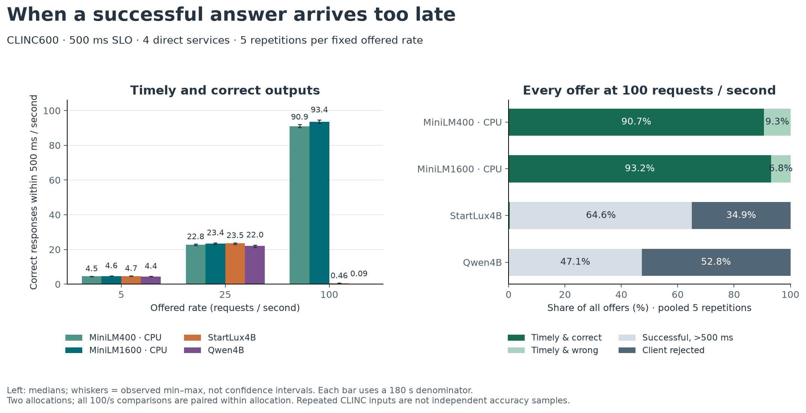
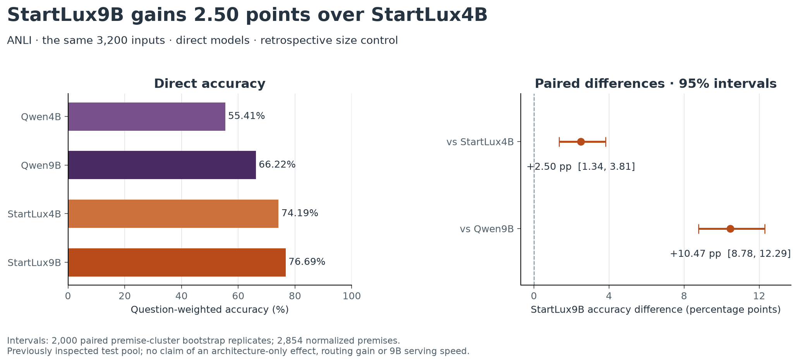

# 后续两项实验：CPU/GPU 服务测量与 StartLux9B 规模对照

2026-11-07 验收，America/Los_Angeles。两项实验都在节点固定提交
`8b5370d8aea7ed57dc42c92f4fe07bcf023a8e07` 上运行，结果包于 11/6 回传。

`clinc-service-v1` 在 CLINC 主测试 600 条上测量四个直接服务，60 个单元、469,804 次计划
请求全部按协议完成。100 请求/秒时，CPU 上的 MiniLM1600 每秒给出 93.43 个 500 ms 内的正确
输出，同一负载下 StartLux4B 和 Qwen4B 只有 0.46 和 0.09 个。5 和 25 请求/秒时四个服务都满足
SLO，25 请求/秒的及时且正确输出在 22.0 到 23.5 个/秒之间。`size-control-anli-v1` 在 V3 的
3,200 道 ANLI test 上补跑 StartLux9B，准确率 76.69%，比 StartLux4B 高 2.50 个百分点，95% 区间
[1.34, 3.81]。

两份原包已按 SHA 归档，11/6 的审计全部 PASS。11/7 从仓库位置重跑了审计脚本，输出与原收据
一致；另写的标准库复算从原始 trace 和预测分片重新计数，结果也一致。

## 回传包与验收

| 项目 | 服务测量 | 规模对照 |
|---|---|---|
| 协议 | `clinc-service-v1` | `size-control-anli-v1` |
| 原包 SHA256 | `d212c130c707a30fc9b99be759e0ec4386000b21fca0792dbe2867b619e0998b` | `f427f7762bac745d9316cb02195c09f98ab551794de1da047509be7f9fe7d1ed` |
| 字节 / 成员 | 156,888,964 / 776 | 4,984,446 / 166 |
| 外部证据根中的归档 | `records/bundles/service-complete-20261106-d212c130c707.zip` | `records/bundles/size-control-complete-20261106-f427f7762bac.zip` |
| 解压目录 | `results/returned-service-complete-2026-11-06` | `results/returned-size-control-complete-2026-11-06` |
| Slurm allocation | 66103994（sc1ns051is14，47 单元）与 66376166（sc1ns052is14，13 单元） | 66376166（sc1ns052is14） |
| 首次读取 gold | 2026-11-06 17:01:35 UTC，60 单元于 17:00:42 全部结束 | 17:11:36 UTC，最后一条预测于 17:11:24 |

验收分四层。

1) 归档。每个成员完整读取并校验 CRC，解压后逐一核对 SHA，归档期间原文件没有变化。
2) 身份与指标（11/6）。服务测量核验 34 个源码文件、输入、15 份到达表和冻结链，从 390,571
   条原始成功响应重新解析并复算全部保存指标。规模对照核验 32 个源码文件和 V3 参照预测的
   hash，从原始响应独立评分并重做 premise 配对 bootstrap。全部 PASS；9B 运行审计记为
   `PASS_WITH_DISCLOSED_METADATA_CONFLICT`，原因见规模对照一节。
3) 重跑（11/7）。四个审计脚本复制到 `audit/` 后从仓库位置重跑，14 份输出中 13 份与原收据
   逐字节一致。`metrics-audit.json` 只有 `archive` 路径字段不同，因为重跑指向 SHA 命名的归档。
4) 第二次复算（11/7）。`audit/recheck_from_raw.py` 只用标准库，不导入项目代码。60 个单元的
   offered、admitted、correct、及时且正确四项计数与包内评价全部一致；9B 的正确数和四格配对
   计数也完全一致。

包内保留的最后一次端口检查报错（11/6 08:32 UTC）早于最终完成。60 个单元各有一次完整
attempt，没有中断过的 attempt 被计入结果。

## 服务测量设计

工作负载是 V1 的 CLINC 主测试 600 条（450 条银行请求、150 条 OOS），按打乱的完整循环发送。
同一轮次、同一速率下，四个条件共用一份 Poisson 到达表和样本顺序。速率为 5、25、100
请求/秒，每单元 180 秒，重复 5 轮，共 60 单元。每轮内条件与速率的执行顺序按固定种子打乱。

Client 有 16 个 worker，active 加排队最多 64 个，每个请求只发一次 HTTP，超时 30 秒。SLO 为
从预定到达到观察到完成不超过 500 ms，其中包括生成器延迟、client 排队和 HTTP；client 满载
拒绝的请求计入分母。每个单元重新启动服务，串行预热 64 条开发输入，结束后停止服务再进入下
一个单元。

MiniLM400 和 MiniLM1600 是 11/4 冻结的 MiniLM 编码器加 LR 分类头，单线程、batch 1，每个请求
都实际执行 tokenize 和编码，没有查表或 embedding 缓存。StartLux4B 和 Qwen4B 沿用 V1 固定的 4B
revision、BF16、原接口与提示，关闭 thinking；同一时间只有一个服务在那张 L40S 上运行，显存
份额 0.4。StartLux 前端 max-inflight 为 16。

## 服务测量结果

下表为 5 轮的中位数，方括号是 5 轮中的最小值与最大值，反映轮次之间的波动。p95 是各单元 p95 的中位数，
完成/秒指成功返回的请求数除以 180 秒，不论是否及时。

| 条件 | 速率 | 及时且正确/秒 | 完成/秒 | p95 ms | 被拒绝 / 计划 | 成功输出准确率 |
|---|---:|---:|---:|---:|---:|---:|
| MiniLM400（CPU） | 5 | 4.52 [4.47, 4.68] | 4.98 | 7.3 | 0 / 4,518 | 90.54% |
| MiniLM400（CPU） | 25 | 22.80 [22.28, 23.12] | 25.16 | 8.6 | 0 / 22,591 | 90.63% |
| MiniLM400（CPU） | 100 | 90.92 [90.26, 92.04] | 100.29 | 14.7 | 0 / 90,342 | 90.66% |
| MiniLM1600（CPU） | 5 | 4.64 [4.59, 4.79] | 4.98 | 7.3 | 0 / 4,518 | 92.99% |
| MiniLM1600（CPU） | 25 | 23.44 [22.92, 23.76] | 25.16 | 8.4 | 0 / 22,591 | 93.18% |
| MiniLM1600（CPU） | 100 | 93.43 [92.75, 94.56] | 100.29 | 15.2 | 0 / 90,342 | 93.16% |
| StartLux4B（GPU） | 5 | 4.67 [4.59, 4.82] | 4.98 | 73.9 | 0 / 4,518 | 93.53% |
| StartLux4B（GPU） | 25 | 23.52 [22.99, 23.81] | 25.16 | 112.1 | 0 / 22,591 | 93.49% |
| StartLux4B（GPU） | 100 | 0.46 [0.32, 0.63] | 64.71 | 1,041.1 | 31,551 / 90,342 | 93.32% |
| Qwen4B（GPU） | 5 | 4.41 [4.33, 4.55] | 4.98 | 191.8 | 0 / 4,518 | 88.35% |
| Qwen4B（GPU） | 25 | 22.01 [21.12, 22.53] | 25.16 | 344.2 | 12 / 22,591 | 88.35% |
| Qwen4B（GPU） | 100 | 0.09 [0.07, 0.14] | 47.48 | 1,419.3 | 47,670 / 90,342 | 88.11% |

5 轮合计，所有已接纳请求都成功返回，失败数为 0。

100 请求/秒时两个 GPU 服务都已饱和。StartLux4B 每秒仍完成 64.71 个请求（5 轮范围
64.17–67.38），Qwen4B 完成 47.48 个（47.19–47.58），排队把几乎全部完成推到了 500 ms 之后。
90,342 次计划请求中，StartLux4B 及时完成 438 次、晚于 SLO 完成 58,353 次、被 client 拒绝
31,551 次（34.9%）；Qwen4B 分别为 102、42,570 和 47,670 次（52.8%）。两个 MiniLM 条件的
90,342 次请求全部及时完成，p95 约 15 ms。

所以 100 请求/秒下 MiniLM1600 与 StartLux4B 约 200 倍的 goodput 比值，描述的是过载点的
状态。容量按完成速率来比较更合适：在这套 client 与 vLLM 配置下，StartLux4B 约每秒 65 个，
Qwen4B 约 47 个；MiniLM 在 100 请求/秒时只用了约 0.5 个 CPU 核，还没有到饱和点。V1 闭环
并发 8 测得 StartLux 在 CLINC 上约 59 个/秒，量级相同，但两次的 client 和服务参数不同。

5 和 25 请求/秒时四个服务都在 SLO 内，及时且正确的输出主要取决于准确率。25 请求/秒的中位数
依次为 StartLux4B 23.52、MiniLM1600 23.44、MiniLM400 22.80、Qwen4B 22.01；Qwen4B 的 12 次
拒绝都出现在 r0。p95 的差别大得多，MiniLM 约 8.5 ms，StartLux4B 112 ms，Qwen4B 344 ms。

每个单元约采样 165 次资源。100 请求/秒时，MiniLM 服务用约 0.51 个 CPU 核，RSS 约
170–198 MiB，启动不到 1 秒。StartLux4B 的 GPU 采样利用率中位数为 96%，显存峰值 19.3 GB，
启动约 118 秒；Qwen4B 为 94%、19.2 GB、116 秒。CPU 条件同样运行在已分配 GPU 的节点上，
GPU 处于空闲状态，没有释放。

GPU 服务在批处理下的标签有少量变化。StartLux4B 的 85,900 次成功响应中，有 2 条输入出现过
两种标签，52 次响应与 V1 记录的标签不同；Qwen4B 的 69,769 次响应中，对应为 8 条输入、
323 次响应。两个 MiniLM 条件的 117,451 次响应与 11/4 保存的预测完全一致。

## StartLux9B 规模对照

新增模型为 StartLux-Decision-v1.1-9B-Instant（revision `18a17f734966b213b2f00fa9c915e8b9af2a9b20`，
BF16，原生温度 1.1014，`gpu_memory_utilization` 0.8）。它在 V3 冻结的 3,200 道 ANLI test 上
直接预测，任务说明与输入和 V3 相同；StartLux4B、Qwen4B、Qwen9B 的预测取自 V3 原包，按 hash
核验后逐题配对。本轮没有拟合、阈值或路由。正式采集前在 90 条开发输入上跑了两遍 smoke，
argmax 完全一致；3,290 条输入的 token 数为 177–356，没有截断。

| 模型 | 正确 / 3,200 | 准确率 | R1（1,000） | R2（1,000） | R3（1,200） |
|---|---:|---:|---:|---:|---:|
| StartLux9B | 2,454 | 76.69% | 84.90% | 75.20% | 71.08% |
| StartLux4B（V3） | 2,374 | 74.19% | 82.60% | 72.70% | 68.42% |
| Qwen9B（V3） | 2,119 | 66.22% | 73.10% | 65.10% | 61.42% |
| Qwen4B（V3） | 1,773 | 55.41% | 64.80% | 53.90% | 48.83% |

| 比较 | 双方都对 | 双方都错 | 只有 9B 对 | 只有对照对 | 差值 | 95% 区间 |
|---|---:|---:|---:|---:|---:|---:|
| StartLux9B − StartLux4B | 2,209 | 581 | 245 | 165 | +2.50pp | [1.34, 3.81] |
| StartLux9B − Qwen9B | 1,862 | 489 | 592 | 257 | +10.47pp | [8.78, 12.29] |

区间来自 2,000 次 premise 簇配对 percentile bootstrap，2,854 个规范化 premise，种子 6998，
估计量为按题等权的合并准确率差。11/7 用 Python 标准随机数生成器重做，得到 [1.28, 3.75] 和
[8.65, 12.20]，差别来自重采样的随机性。

9B 在三个 round 上都高于 4B。按 gold 标签看，entailment 从 70.47% 升到 76.07%，neutral 从
76.40% 升到 79.21%，contradiction 从 75.71% 略降到 74.76%。

V3 中以 Qwen9B 为后级的冻结政策，在同一 3,200 题上最高为 74.41%（class_conditional）；
直接换成 StartLux9B 为 76.69%。两者的测试时计算量不同，StartLux9B 的服务成本也没有测量，
这一对比只作描述。

采集在 sc1ns052is14（job 66376166）上串行进行，3,200 条正式预测用时 141.8 秒，零错误、零
重试。启动命令和 engine 日志都显示 prefix caching 已关闭，health 接口的 `prefix_cache` 字段
却为 true，与 V3 的情况相同；这里以启动配置为准，原 health 响应保留不改。关闭阶段日志中的
EngineDeadError 出现在主动停止服务之后，此时 3,200 条预测已全部完成。

## 解释边界

1) 两项都在已经评价过的 test 上进行，属于回顾性对照。CLINC 600 条在 V1 和 11/4 的轻量基线
   中评价过，ANLI 3,200 题在 V3 中评价过；本轮没有据此选择模型、阈值或路由。
2) 服务测量只包含四个直接服务，没有级联条件，也没有测量 9B 的服务性能或与 4B 同卡驻留。
3) 速率 5、25、100 是预先固定的三个点，没有专门定位各服务的饱和点。容量数字依赖本节列出的
   client 和 vLLM 配置。
4) CPU 条件运行在已分配 GPU 的节点上，单线程推理并不独占一个 CPU 核，结果没有换算成美元成本。
5) 47 个单元在第一个 allocation，13 个在第二个，两台节点的 L40S 和 CPU 亲和集不同。每组
   "轮次 × 速率"内的四个条件都在同一 allocation 上配对，只有 r3 的 5 请求/秒一组例外，其中
   MiniLM400 在第二台上运行。按 allocation 拆开看，100 请求/秒的方向一致，StartLux4B 的及时
   且正确输出在第一台为 0.41/秒（4 轮均值），在第二台为 0.63/秒。
6) 重复请求不增加独立样本。服务测量中的准确率只用于计算 goodput，质量比较以 V1 和 11/4 的
   报告为准。
7) 11/6 曾在本机发现一个 80 MB 的服务中间包（31 个完成单元，含端口检查报错，SHA
   `165134a176c5df7228d1dc51453220b8073ed1c1f3403161490cc4e6321246e4`）。它没有按 SHA 归档，
   之后被同名的最终包经 iCloud 覆盖，只剩元数据记录在
   [service-local-transfer-2026-11-06.json](../../records/service-local-transfer-2026-11-06.json)。
   最终包包含全部 60 个单元。

## 后续

服务和 9B 两组数字可以接入课程报告和 Decision Lab。若报告要比较"换更大的前级"和"加生成式
后级"的成本，还缺 StartLux9B 的服务测量，需要另立协议在节点上运行。

## 证据与复现

- 评价副本 [service-evaluation.json](service-evaluation.json)、[size-evaluation.json](size-evaluation.json)
  与包内 `evaluation.json` 逐字节一致。
- 11/6 审计收据在 `evidence/service/` 和 `evidence/size/`，11/7 第二次复算在
  [evidence/raw-recheck-2026-11-07.json](evidence/raw-recheck-2026-11-07.json)。
- 脚本和重跑命令见 [audit/README.md](audit/README.md)。
- [render_figures.py](render_figures.py) 只读取本目录的两份评价副本。
- 验收记录 [followups-acceptance-2026-11-06.json](../../records/followups-acceptance-2026-11-06.json)，
  原包索引见 [BUNDLE_INDEX.json](../../records/BUNDLE_INDEX.json)，本目录文件 SHA 见
  [SHA256.json](SHA256.json)。
- 协议见 [SERVICE_STUDY_PROTOCOL_ZH.md](../../docs/SERVICE_STUDY_PROTOCOL_ZH.md) 和
  [SIZE_CONTROL_PROTOCOL_ZH.md](../../docs/SIZE_CONTROL_PROTOCOL_ZH.md)，运行入口见
  [RUN_FOLLOWUPS_ZH.md](../../docs/RUN_FOLLOWUPS_ZH.md)。
