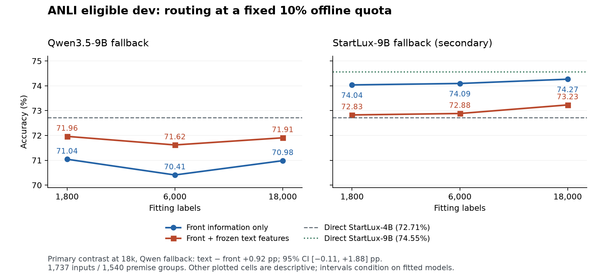

# ANLI 可学习互补性：回传验收与结果

2026-11-15（America/Los_Angeles）。本轮完整研究已经跑完并通过回传验收，无需续跑。节点状态为 COMPLETE；原始包完成时间为 2026-11-16 04:38 UTC，即本地 11/15 20:38 PST。

预定主比较中，加入冻结文本特征比仅使用前级信息多答对 16 题，提升 **0.921 个百分点（pp），95% CI [−0.114, +1.882] pp**。区间跨零，尚不能确认可靠收益；上界超过预先列出的 1 pp 实用参照，也不能宣称已经排除了有实际意义的改善。1 pp 不是等效性界值。

这一路由配置的准确率为 71.91%，仍低于直接 StartLux-4B 的 72.71%，少答对 14 题。本轮不支持“文本路由已超过直接前级”或“已经学会稳定利用后级互补性”的结论。

## 做完了什么

固定源码为 `41dfb7547698691634fa0e5a4b8f87824436fc8f`，科学协议 revision 1 未改变。公司单张 L40S、Slurm job 3467005 上完成开发预检、正式预测、冻结 MiniLM 特征、路由器拟合／选择、分数冻结和最终评价。记录总时长约 **3 小时 1 分钟**。

| 数据角色 | 输入数 | 规范化 premise 组数 | 用途 |
|---|---:|---:|---|
| fitting | 18,000 | 4,813 | 1,800／6,000／18,000 嵌套训练量 |
| selection | 900 | 93 | 固定候选中的 L2 与部署阈值选择 |
| eligible dev | 1,737 | 1,540 | 预定主评价总体 |
| train-source holdout | 1,800 | 199 | 次要的跨来源结果比较 |

四种角色的 premise 组互不重叠。三个模型各预测 22,437 条，共 **67,311 条正式模型预测**；另有 270 条旧开发预检预测。所有正式请求一次成功。12 个配置覆盖两个后级 × 三档训练量 × 两类特征，各有三个 L2 候选；拟合记录中共有 72 个 head 记录。前级模型始终为 StartLux-4B，LLM 权重和文本编码器均冻结。

这里的 `front` 使用前级输出信息；`text` 在同样的前级信息上增加冻结文本特征。主要结果按分数在整批评价输入中选取精确离线配额 `floor(0.1N)`，eligible dev 转交 173 条（9.96%），train holdout 转交 180 条。该批量排序不是在线预算控制。

## 预定主比较与直接模型

下表是 eligible dev 的 1,737 条输入；路由行均为 18,000 fitting 标签。只有 Qwen 后级的 text−front 是预定主比较，其余行用于解释结果。

| 方法 | 正确数 | 准确率 | 转交数 | 纠正／伤害 |
|---|---:|---:|---:|---:|
| 直接 StartLux-4B | 1,263 | 72.71% | — | — |
| 直接 Qwen3.5-9B | 1,072 | 61.72% | — | — |
| 直接 StartLux-9B | 1,295 | 74.55% | — | — |
| Qwen 后级，front 路由 | 1,233 | 70.98% | 173 | 7／37 |
| Qwen 后级，text 路由 | 1,249 | 71.91% | 173 | 14／28 |
| StartLux-9B 后级，front 路由 | 1,290 | 74.27% | 173 | 39／12 |
| StartLux-9B 后级，text 路由 | 1,272 | 73.23% | 173 | 18／9 |

纠正指前级错误、转交后正确；伤害指前级正确、转交后错误。主比较的文本特征减少了一部分伤害，但仍有 28 次伤害对 14 次纠正，未超过直接 4B。次要的 StartLux-9B 后级结果中，front 反而高于 text；不能将 Qwen 的方向推广到所有后级。

主区间用固定的 2,000 次配对规范化 premise 分组 bootstrap，每次重排精确配额，条件于已拟合模型；没有包含重新抽取训练数据、重新拟合或重新选择模型的全部不确定性。按 round 标准化的主差值为 +0.849 pp，仅是预定敏感性点估计，不消除 eligible 子集的筛选限制。

## 训练量与另一评价来源

Qwen text 的三个训练量分别为 71.96%、71.62%、71.91%，没有随标签增加而单调改善。StartLux-9B front 从 74.04% 升到 74.27%，但这些次要点估计不能单独证明稳定的样本量效应。

train-source holdout 上，同一 Qwen/18k 主配置的 text−front 为 **−0.611 pp，95% CI [−1.212, +0.220] pp**（1,591 对 1,602 题）；直接 4B 为 1,609/1,800＝89.39%，直接 9B 为 1,643/1,800＝91.28%。两来源上的差值方向不同，未验证稳定迁移，也不能把这一差异直接归因于某个已隔离的分布因素。

因此，现有学习曲线不足以支持继续按相同配方扩大标签量或重复运行来期待收益。它也不是“互补性不可学习”的证明；当前证据仅覆盖冻结特征、规定的线性 head、候选超参数及保留评价子集。

## 互补性存在，但知道该转交谁仍是问题

在同一 eligible dev 上，Qwen 后级的精确配额 confidence 为 72.25%，固定随机对照为 71.96%，知道真实标签的 hindsight oracle 为 80.54%（相对直接 4B +7.83 pp）。Oracle 纠正 136 题且没有伤害；173 次转交中的其余请求不改变正误。

这说明在已观察的模型答案里确有可利用的互补性；不代表路由器在预测时可以获得这些标签，也不是可实现的性能保证。主 text 路由仍未达到 confidence 对照的观测准确率。后者是描述性比较，没有新增确认性检验或事后重新挑选主方法。

## 选择集 10% 阈值不保证评价集 10%

独立的部署阈值参照允许零转交，并只在 selection 上要求至多 10%。它与上面的离线精确配额必须分开报告。

| 18k 配置，eligible dev | 冻结阈值实际转交 | 准确率 | 离线配额转交 |
|---|---:|---:|---:|
| Qwen，front | 0（0.00%） | 72.71% | 173 |
| Qwen，text | 64（3.68%） | 72.31% | 173 |
| StartLux-9B，front | **438（25.22%）** | 74.32% | 173 |
| StartLux-9B，text | 156（8.98%） | 73.29% | 173 |

StartLux-9B/front 在新总体上的实际转交率为 25.22%，超过选择集的 10% 转交约束。这是这轮重要的部署边界证据，不能写成固定阈值实现了在线 10% 预算。这里没有测量在线限额器或到达负载下的 SLO；模型串行采集延迟也不能替代服务实验。

## 验收与证据范围

原始 ZIP SHA-256 为 `08d88006855aef956bac8722293e24f333afd6cb4249f400dd9393cdf9649874`，76,459,118 字节。安全解包后核对 1,455 个清单文件；清单自身和 omitted 清单按冻结导出器规则另行处理。原包和解压内容已按 SHA 保存于 Git 外，见[正式验收](../../records/anli-learnability-2026-11-15-acceptance.json)和[证据位置](../../docs/ARTIFACTS_ZH.md)。

- 固定发布版本的官方审计返回 `PASS_PACKAGED_EVIDENCE`；152 个源码文件身份一致。
- 独立对照固定 SHA 的官方 ANLI ZIP，22,437 条输入与全部 gold 逐项一致，分组隔离和嵌套配额吻合。
- 独立重解析全部 67,311 条原始回答，复算两总体的所有指标和两组 2,000 次 bootstrap。错误正确数／区间负向检查被发现。
- 72 个 head 记录均有效且记载收敛；独立复算 36 个 front-head 目标／梯度、front 候选选择与阈值，以及 21,222 个冻结评价分数，最大分数误差 `2.22e-16`。
- 独立重分词核对 44,874 个文本字段、1,902,732 个 token，最长字段 214 token，无截断或溢出。Linux 原生进程归属自检通过，无关 decoy 存活；9 份阶段停止记录均显示 GPU 清空。拟合／分数冻结先于评价 gold 读取，收据链一致。

**精简包省略了 176 份 embedding 数组。** 它们的 SHA 已绑定，但这次不能从数组独立重放 text-head 的训练梯度、分数和阈值优化；不能把此次验收写成完整文本拟合重现。节点上的 `results/aux-anli-learnability-v1-r2/collection/embeddings/` 应保留，之后可补存这些数组或按冻结实现和环境重建后核验。[审计说明](audit/README.md)区分了原始复算与这一限制。

eligible dev 是官方 3,200 条 dev 中排除已知 premise 暴露后留下的 1,737 条，不是完整 dev 的无偏估计。train holdout 也受预定分组与配额选择影响。Ju 已说明“据我所知没有额外使用”；这是有范围限定的来源声明，不是对所有机器、成员或上游训练的独立证明。原始 [NODE_REPORT.md](NODE_REPORT.md) 中“External usage is unconfirmed”保留原字节，由[后续用户声明](../../records/anli-learnability-full-2026-11-13/external-usage-statement-2026-11-15.json)和本段补充其时序。

## 接下来

先将本轮作为“可学习互补性”的独立研究整合论文，保留 +0.921 pp 区间及直接模型对照，并单列阈值预算失效。论文 PDF 和 demo 目前尚未纳入本轮，不能用旧展示页代表新增研究。

两套评价结果现在都已查看，不能再用它们选择特征或超参数后宣称独立确认。若继续小编码器训练或在线预算控制，应另定研究问题、选择流程与未使用的确认数据；目前没有启动这些额外实验。本轮成功完成，不需要再跑同一 GPU 流水线。
