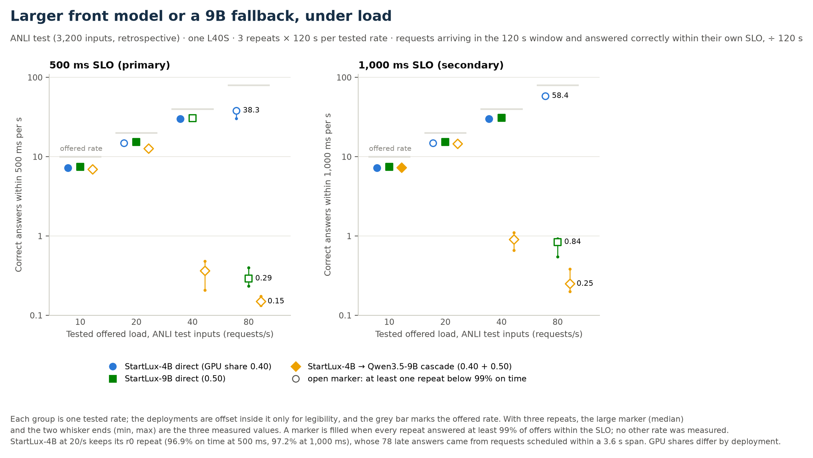

# 9B 服务成本：换更大的前级，还是给 4B 加 9B 后级

ANLI 服务测量，正式测量 2026-11-09（UTC 15:29–18:07），独立验收 2026-11-10，报告整理 2026-11-10。
实验源码 `7c81947`、协议 revision 4；正式包 SHA-256
`9baeca3eb7f84a86fdc1f63bc16114c1a91c756bbefe323840152d7901f91be7`，预检包
`8adafb29ff4501e55c4a5c3e9572d97a63a5e6d82e63cf862d86b54d14589ce3`。验收收据为
[upgrade-service-acceptance-2026-11-10.json](../../records/upgrade-service-acceptance-2026-11-10.json)，
复审意见见 [结果与交付复审](../../docs/UPGRADE_RESULTS_REVIEW_2026-11-10_ZH.md)。

## 研究的问题

V3 在 ANLI 上冻结的 positive_gain 路由一次也没有转交；11/6 的规模对照显示 StartLux-9B 直接预测比
StartLux-4B 高 2.50pp（95% CI [1.34, 3.81]pp），也高于所有评估过的 9B 生成式后级级联。那次对照只测了
质量。这次在同一张 L40S 上测三种固定部署的服务表现，问题是在相同的到达流量下，换成更大的前级模型和
给 4B 加一个 Qwen3.5-9B 后级，哪一种在时限内给出更多正确回答。

这是 V3 之后单独做的回顾性 follow-up。V1/V2/V3 的预定主比较和负结果保持原样，本报告不替代它们。

## 实验设置

| 部署 | 服务 | vLLM 显存份额 | 路由 |
|---|---|---|---|
| StartLux-4B 直接 | StartLux-Decision-v1.1-4B-Instant | 0.40 | 无 |
| StartLux-9B 直接 | StartLux-Decision-v1.1-9B-Instant | 0.50 | 无 |
| 级联 | 前级 StartLux-4B（0.40）＋后级 Qwen3.5-9B（0.50），两引擎同卡驻留 | 合计 0.90 | V3 冻结的 `qwen9b/class_conditional`，阈值 0.2729 |

- 输入是 V3 的 3,200 条 ANLI test（已在 V3 和规模对照中评分过），按打乱的完整轮次循环；90 条
  development 输入只用于每单元的串行预热。
- 到达为 Poisson 过程，10、20、40、80 请求/秒；每单元 120 秒，三轮重复，共 36 个单元。同一轮同一速率下
  三种部署共用同一到达表和样本顺序。每单元重新启动并预热服务。
- 客户端 16 个 worker，在途加排队上限 64，超出即记为客户端拒绝；每次模型调用只尝试一次，单请求预算
  30 秒。三个 vLLM 引擎都加了 `--max-num-seqs 64`（revision 4 的唯一改动，原因见协议）。
- SLO 从计划到达时刻起算，包含客户端排队。主 SLO 500 ms，次 SLO 1,000 ms。
- **正确 goodput** = 120 秒到达窗口内的请求中，在各自 SLO 内返回且标签正确的数量 ÷ 120 秒。请求按计划
  到达时间选入窗口，是否及时按每个请求自己的 SLO 判断，所以及时的回答可以在到达窗口结束后不久才完成。
  被拒绝的请求和晚到的正确回答都计入 offered，不计入分子。这个量从实际返回的标签计数，和“全部成功回答的
  吞吐”或“历史准确率 × 吞吐”是不同的量。
- 级联政策是 V3 离线最准确的冻结级联，测量前已固定，没有按服务结果重选；它不代表级联服务表现的上限。

36 个单元都在同一个 Slurm allocation（job 1224376）和同一张 L40S 上依次运行，每单元只有一次尝试。

## 正确 goodput

500 ms 内正确回答数/秒，三轮中位数 [最小，最大]。三轮时，这三个数就是三次测量值。

| 部署 | 10 请求/秒 | 20 请求/秒 | 40 请求/秒 | 80 请求/秒 |
|---|---:|---:|---:|---:|
| StartLux-4B（0.40） | 7.258 [7.200, 7.292] | 14.850 [14.125, 15.050] | 29.958 [29.267, 30.150] | 38.258 [30.225, 40.658] |
| StartLux-9B（0.50） | 7.467 [7.417, 7.692] | 15.333 [14.567, 16.083] | 30.750 [30.133, 31.017] | 0.292 [0.233, 0.400] |
| 级联（0.40 + 0.50） | 6.950 [6.825, 7.042] | 12.758 [12.367, 13.208] | 0.367 [0.208, 0.483] | 0.150 [0.133, 0.175] |

1,000 ms 内正确回答数/秒：

| 部署 | 10 请求/秒 | 20 请求/秒 | 40 请求/秒 | 80 请求/秒 |
|---|---:|---:|---:|---:|
| StartLux-4B | 7.258 [7.200, 7.292] | 14.850 [14.125, 15.108] | 29.958 [29.267, 30.150] | 58.408 [57.658, 59.600] |
| StartLux-9B | 7.467 [7.417, 7.692] | 15.333 [14.567, 16.083] | 31.025 [30.158, 31.158] | 0.842 [0.550, 0.925] |
| 级联 | 7.308 [7.175, 7.392] | 14.558 [14.125, 15.400] | 0.908 [0.658, 1.108] | 0.250 [0.200, 0.383] |

在四个已测速率上，直接 9B 的中位正确 goodput 都高于这个冻结级联。级联在 40 请求/秒已降到每秒不足
1 个正确且及时的回答，直接 9B 在 80 请求/秒出现同样的下降。80 请求/秒时直接 4B 明显最好，500 ms 下为
38.258/秒，1,000 ms 下为 58.408/秒。10–40 请求/秒时直接 9B 的中位数比 4B 高 0.2–1.1 个/秒；这几档两者
每轮的及时比例都在 96.8% 以上，差距主要反映准确率（实时合并准确率 76.64% 对 74.17%）。

## 99% 及时成功规则

协议规定的容量描述是：三轮每一轮都至少有 99% 的 offers 在 SLO 内成功返回。下表列出满足规则的全部已测
速率，括号内是四个速率各自三轮中最差一轮的及时比例。

| 部署 | 500 ms 下通过的速率 | 500 ms 最差一轮（10/20/40/80） | 1,000 ms 下通过的速率 | 1,000 ms 最差一轮 |
|---|---|---|---|---|
| StartLux-4B | 10、40 | 100% / 96.88% / 100% / 50.66% | 10、40 | 100% / 97.23% / 100% / 96.61% |
| StartLux-9B | 10、20 | 100% / 100% / 98.87% / 0.42% | 10、20、40 | 100% / 100% / 100% / 0.92% |
| 级联 | 无 | 93.50% / 78.92% / 0.63% / 0.20% | 10 | 100% / 98.08% / 2.07% / 0.32% |

通过集只描述这四个已测速率。4B 在 20 请求/秒未通过、40 请求/秒三轮都是 100%，所以最高通过点不能当作
连续的稳定容量，也不能推断两个已测速率之间的表现。

40 请求/秒、500 ms 时，9B 的中位正确 goodput（30.750）略高于 4B（29.958），但 9B 最差一轮及时比例为
98.87%，没有达到 99% 规则，4B 三轮都是 100%。正确 goodput 衡量单位时间的正确产出，99% 规则衡量每一轮
是否几乎全部及时，两项指标回答不同的问题。

## 吞吐、拒绝与延迟

80 请求/秒时三种部署的差别主要来自能处理多少请求。下列为三轮的范围。

| 部署（80 请求/秒） | 成功返回/秒（含晚到） | 客户端拒绝比例 | 已接纳请求 p95 延迟 |
|---|---:|---:|---:|
| StartLux-4B | 77.79–80.26 | 1.13–3.30% | 738.6–809.5 ms |
| StartLux-9B | 47.54–48.33 | 39.94–41.43% | 1,350.9–1,370.0 ms |
| 级联 | 34.77–35.08 | 56.40–57.17% | 2,652.3–2,682.0 ms |

全部 162,801 次 offers 中，131,935 次成功返回，30,866 次被客户端并发上限拒绝，没有模型错误、超时、
deadline 或其他失败状态。拒绝只出现在过载单元。级联的实时转交比例为每单元 23.31–24.71%（同一政策在
3,200 条历史预测上转交 766 条，即 23.94%），实时路由与历史路由一致 99.05–99.48%。

## 质量：实时成功回答与匹配的历史预测

实时准确率只在成功返回的请求上计算，按每个 offer 计权；高负载下被拒绝或排队的请求不同，成功子集随负载
改变。因此应和同一批成功请求（相同输入、相同出现次数）对应的历史预测比较，而整池历史准确率另列。

| 部署 | 成功回答 | 实时准确率（合并） | 同一成功子集的历史准确率 | 逐单元实时准确率范围 | 整池历史准确率（3,200 条） |
|---|---:|---:|---:|---:|---:|
| StartLux-4B | 53,609 | 74.1741% | 74.1237% | 73.16–75.28% | 74.1875% |
| StartLux-9B | 42,466 | 76.6448% | 76.6401% | 76.16–77.44% | 76.6875% |
| 级联 | 35,860 | 74.1188% | 74.3419% | 73.43–75.80% | 74.40625% |

实时与匹配历史的差在逐单元层面为 4B −0.17 至 +0.26pp、9B −0.09 至 +0.26pp、级联 −0.59 至 0pp。
两者接近，这只说明服务时的标签与离线保存的标签大体一致，不构成等价检验。3,200 个输入中出现过不止一种
实时标签的数量为 4B 33 个、9B 19 个、级联 49 个；批次组成、数值非确定性或路由分数接近阈值都可能造成
这种变化，本研究没有分离原因。重复的服务请求不增加独立的质量样本。

## 显存与 KV

正式单元的 KV 容量取自每次引擎启动的实际日志：

| 部署 / 角色 | 份额 | 正式启动次数 | 正式 KV | 预检 KV（11/9 早些时候） |
|---|---|---:|---|---|
| StartLux-4B 直接 | 0.40 | 12 | 8.78 GiB，234,549 tokens | 8.05 GiB，215,147 tokens |
| StartLux-9B 直接 | 0.50 | 12 | 4.22 GiB，112,532 tokens | 2.93 GiB，78,039 tokens |
| 级联前级 StartLux-4B | 0.40 | 12 | 8.78 GiB，234,549 tokens | 8.78 GiB，234,549 tokens |
| 级联后级 Qwen3.5-9B | 0.50 | 12 | 4.22 GiB，112,532 tokens | 2.93 GiB，78,039 tokens |

正式测量期间的 GPU 显存采样峰值（每单元一个峰值，取 12 个单元的范围）为 4B 17.75–19.52 GiB、
9B 22.00–22.65 GiB、级联 39.72–40.38 GiB。这些数值来自整张卡的周期采样（每单元约 110 次），两次采样之间
的瞬时峰值可能更高，也没有按进程拆分。本研究不计算美元成本。早期预检的 9B KV 为 2.93 GiB，正式单元都是 4.22 GiB，所以预检数字不能代表正式配置。
预检前后 CUDA graph 占用与 KV 的变化是一起观测到的，没有单独的因果解释。

## 预检与正式测量的区别

revision 4 预检在正式测量前约 8 小时完成（07:35–07:49 UTC），三个条件都通过：4B 和 9B 各自 310/310
在 500 ms 内成功；级联预检强制每个请求都转交，310/310 成功、69 个在 500 ms 内，p50 624.6 ms、
p95 969.1 ms。强制转交的时延包含前级、后级和客户端调度排队。这次预检验证了两个引擎可以同卡驻留运行，
正式约 24% 转交政策的表现以正式单元为准。

预检记录的 “148 秒重叠” 是不同请求的前后级 HTTP 区间两两求交后的累计值（独立重算 147.9986 秒），会重复
计时；两个接口同时有请求在途的墙钟并集为 14.7769 秒。两个数都按 HTTP 区间计算，无法据此判断 GPU kernel
是否并行。

## 4B 20 请求/秒的异常轮

`r0-startlux4b-rate20` 有 78 个请求超过 500 ms，另有 1 次客户端拒绝；该单元 500 ms 及时比例 96.875%，
1,000 ms 为 97.231%。这 78 个请求的计划到达时间集中在 110.6489–114.2715 秒（跨度 3.6226 秒）。它们的
客户端排队中位 1,271.92 ms，worker 计时中位 228.20 ms，记录的模型调用中位 225.32 ms；最大派发延迟
162.52 ms，worker 计时减去模型调用计时的最大值为 2,896.75 ms。明显的等待发生在模型调用计时之外。
trace 写入与 worker 起止计时共用一把锁，但现有记录无法确定 I/O、锁竞争、JIT 或操作系统调度中哪一个
是原因。按协议这一轮原样保留、不重测，所有汇总和图都包含它。逐请求时间见
[stall_late_rows.csv](evidence/metrics/stall_late_rows.csv)。

## 解释边界

- 三种部署的显存份额、模型和计算量都不同（0.40、0.50、0.90）。本研究比较三个固定部署，差异不能归因于
  模型规模、架构、训练数据或同驻留本身；各部署的容量也没有单独优化。
- 质量来自 V3 已经评分过的 ANLI test，属于回顾性分析；级联政策也是事后从 V3 结果中选出的。
- 三轮重复描述服务的波动，没有做显著性检验；重复请求不是新的独立质量样本。
- 结论限于这一张 L40S、这一组客户端与 vLLM 设置（16 worker、上限 64、`max_num_seqs` 64、关闭 prefix
  caching）和四个已测速率。
- health 接口报告 `prefix_cache=true`，与实际启动参数和有效配置（关闭）不一致，和 V3 相同，已披露。
- 每单元的 `finished.json` 停止收据单独核验存在与内容，但没有单独进入 freeze 的文件 SHA 清单。

## 复核

[`audit/`](audit/README.md) 中的两个标准库脚本直接读取原始 ZIP，不导入生产评价或核验代码，也不调用模型：
`audit_integrity.py` 做 2,097 项身份、生命周期与预检检查，`audit_metrics.py` 从原始 trace 重算全部
36 个单元的 500/1,000 ms 指标、140,576 个 stage 预测与原始 HTTP 返回的一致性、35,860 次实时路由和
9,600 条历史预测。两者是 11/10 验收脚本的便携版本，只改了输入输出位置；在本机重跑的 6 份输出与验收收据
逐字节一致。`bash scripts/reproduce_cpu.sh --strict` 会运行这两个脚本并逐字节比较 `evidence/` 中的收据，
外部证据缺失时 strict 失败。

`build_tables.py` 只读 `evidence/` 中的收据生成 `summary.csv`、`quality.csv`、`resources.csv`，写出前
会从 36 个单元重算中位数、通过集与总数并和验收汇总比较；`render_figures.py` 由 `summary.csv` 画图。

## 文件

| 文件 | 内容 |
|---|---|
| [evidence/metrics/cells.csv](evidence/metrics/cells.csv) | 36 个单元的逐单元指标（独立重算的验收收据） |
| [summary.csv](summary.csv) | 部署 × 速率 × SLO 的 24 行汇总：三轮数值、中位数、范围、及时比例与通过标记 |
| [quality.csv](quality.csv)、[resources.csv](resources.csv) | 质量对照；KV、启动时间与显存采样峰值 |
| [evidence/metrics/](evidence/metrics/) | 指标审计收据、重算的单元与汇总、异常轮分析 |
| [evidence/integrity-audit.json](evidence/integrity-audit.json) | 完整性审计收据（2,097 项检查） |
| [figures/](figures/) | 正确 goodput 图（PNG、SVG） |
| [SHA256.json](SHA256.json) | 本目录全部文件的 SHA-256 |

原始 ZIP、gold 与 V3/规模对照的预测包都在 Git 之外，位置见 [ARTIFACTS_ZH.md](../../docs/ARTIFACTS_ZH.md)。
