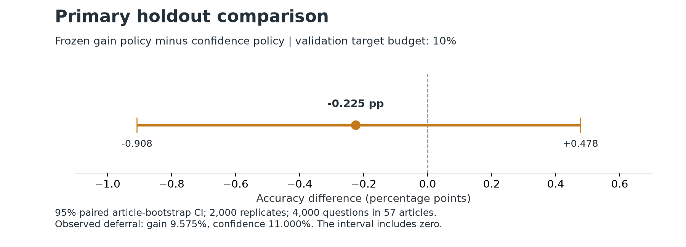
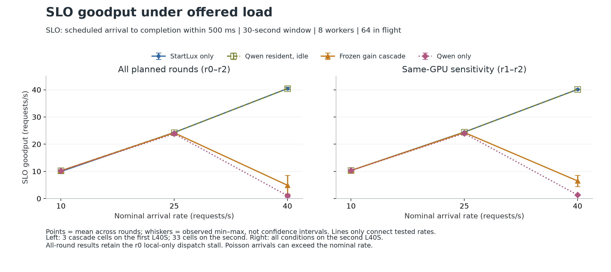

# V2 完整回传与研究结果

核对日期：2026-11-03，America/Los_Angeles。包导出于本地 00:28:52（UTC 08:28:52）。

**V2 已完成并通过独立验收。** 原 10,800 条预测和政策冻结保持不变，36/36 个性能单元完整，首次记录的 holdout 访问与最终评价身份、时序一致。主比较没有显示 gain 优于 confidence；完整测量也揭示了该级联在高负载下的服务代价。这是可报告的研究结果，无需为追求正结果重跑或修改冻结政策。

## 质量主结果

本次任务是 **SQuAD2 可答性二分类**，不是自由文本答案的 EM/F1。新 holdout 为 4,000 个问题、57 篇项目此前未使用的 train 来源文章，可答/不可答各 2,000。目标是类别平衡样本中的问题等权准确率；它不代表一般生产分布，也不证明基础模型预训练未见这些文章。

主终点为验证集 10% 目标转交预算下，两种冻结在线政策的准确率差。gain 相对 confidence 少答对 9 题，差 **−0.225 个百分点，95% 文章配对 bootstrap 区间 [−0.908, +0.478] 个百分点**。2,000 次重采样、种子 6998 的独立计算与保存结果完全一致。区间跨 0，证据不足以确认改善，也不能宣称等效或已证明劣于对照。

| 政策/模型 | 正确数 | 准确率 | 实际转交 | 救回 | 误伤 | 相对 StartLux 净正确数 |
|---|---:|---:|---:|---:|---:|---:|
| StartLux 直接预测 | 3,671/4,000 | 91.775% | — | — | — | — |
| Qwen 直接预测 | 3,438/4,000 | 85.950% | — | — | — | — |
| gain，冻结主候选 | 3,664/4,000 | 91.600% | 383（9.575%） | 0 | 7 | -7 |
| confidence，冻结主对照 | 3,673/4,000 | 91.825% | 440（11.000%） | 93 | 91 | +2 |
| 原 v1 gate，次要描述 | 3,693/4,000 | 92.325% | 219（5.475%） | 61 | 39 | +22 |

救回指 StartLux 错、转交后 Qwen 对；误伤反之。直接 Qwen 的“转交”不适用，因为全部输入直接调用 Qwen。两端直接结果和原 v1 gate 是次要描述性参照。gain 与 confidence 的实际转交率分别为 9.575% 与 11%，不是严格等调用量比较；阈值从 validation 冻结后没有按 holdout 重排配额。

gain 在 validation 比 confidence 多答对 9/1,000（+0.9pp），但在独立 holdout 少答对 9/4,000。它转交的 383 题没有救回，误伤 7 题；这显示这套冻结政策在该 holdout 上的收益未泛化。不能仅以 Qwen 整体较弱解释所有失败，因为整个 holdout 中仍有 119 题是 StartLux 错而 Qwen 对；另外 352 题方向相反。存在互补题不等于能在看不到 gold/Qwen 输出时可靠找到它们。

此前校准/验证集的 gain 分数均为负；固定预算选择的是预测损失最小的一部分，并不保证正收益。这能帮助解释当前政策设计，但不构成精确因果归因，也不允许在此 holdout 上修改阈值、特征后重新宣称验证性改善。

## 预定预算敏感性

以下是预先列出的描述性比较，没有对多组比较做显著性校正。5% 目标下的 class-conditional 达到 92.900%，比直接 StartLux 多对 45 题；它在 validation 的该预算下也被选中。但实际转交率为 6.5%，不能称为严格 5% 测试预算，不能把它升为本轮主结果，也不能套用 gain 的实测速度。

| validation 目标预算 | 政策 | holdout 准确率 | 实际转交率 | 救回 / 误伤 |
|---|---|---:|---:|---:|
| 5% | confidence | 92.250% | 4.950% | 55 / 36 |
| 5% | class_conditional | 92.900% | 6.500% | 92 / 47 |
| 5% | gain | 91.725% | 4.850% | 0 / 2 |
| 10% | confidence | 91.825% | 11.000% | 93 / 91 |
| 10% | class_conditional | 91.725% | 11.625% | 105 / 107 |
| 10% | gain | 91.600% | 9.575% | 0 / 7 |
| 20% | confidence | 90.100% | 21.200% | 109 / 176 |
| 20% | class_conditional | 90.025% | 20.900% | 115 / 185 |
| 20% | gain | 91.550% | 17.725% | 0 / 9 |

## 性能结果

固定 200 个 validation 输入重复构成负载。四条件 × 10/25/40 请求每秒 × 三轮，共 36 单元；每单元 30 秒 Poisson offered window、8 个 worker、最多 64 个在途请求，500ms SLO。相同速率/轮次的到达表匹配。所有 26,984 个 offered 请求中，25,998 个被接纳并成功，986 个因队列满而拒绝；请求失败和重试均为 0。含预热共 27,457 个底层模型调用的原响应和冻结路由通过核验。

goodput 为“成功且在预定到达后 500ms 内完成的请求数 / 30 秒”。拒绝与迟到完成均不计入 goodput；下表 p95 为已接纳请求从预定到达到完成的时延。三轮均值与范围是描述性结果，范围不是置信区间，p95 均值也不是把所有请求混合后的 p95。

| 条件 | 目标请求/秒 | goodput/秒：均值 [最小, 最大] | 每轮 p95 的均值 [最小, 最大]，ms | 三轮总拒绝数 |
|---|---:|---:|---:|---:|
| StartLux 单独 | 10 | 9.944 [9.200, 10.400] | 487.3 [85.7, 1290.3] | 0 |
| StartLux 单独 | 25 | 24.289 [24.000, 24.433] | 111.6 [109.9, 114.8] | 0 |
| StartLux 单独 | 40 | 40.433 [40.067, 41.033] | 126.3 [122.7, 130.5] | 0 |
| 双模型驻留、仅调用 StartLux | 10 | 10.233 [10.067, 10.400] | 89.2 [87.4, 90.3] | 0 |
| 双模型驻留、仅调用 StartLux | 25 | 24.289 [24.000, 24.433] | 111.2 [110.6, 111.8] | 0 |
| 双模型驻留、仅调用 StartLux | 40 | 40.433 [40.067, 41.033] | 125.4 [122.3, 127.2] | 0 |
| 冻结 gain 级联 | 10 | 10.233 [10.067, 10.400] | 229.9 [227.5, 231.7] | 0 |
| 冻结 gain 级联 | 25 | 24.167 [23.900, 24.400] | 363.6 [350.6, 382.5] | 0 |
| 冻结 gain 级联 | 40 | 4.889 [1.700, 8.567] | 1970.4 [1927.6, 2000.0] | 325 |
| Qwen 单独 | 10 | 10.233 [10.067, 10.400] | 248.8 [244.9, 255.2] | 0 |
| Qwen 单独 | 25 | 23.833 [23.533, 24.367] | 434.2 [399.2, 473.8] | 0 |
| Qwen 单独 | 40 | 1.056 [0.533, 1.533] | 2085.2 [2062.8, 2105.4] | 661 |

在 40 请求/秒时，StartLux 单独与双模型驻留但 Qwen 空闲的 goodput 都为 40.433/秒；冻结 gain 级联为 4.889/秒，Qwen 单独为 1.056/秒。级联仍能完成大量请求，但排队后多数超过 500ms，不能把 4.889 误读成总完成吞吐或模型正确率。Poisson 实际到达数会围绕名义速率波动，所以 goodput 略高于 40 合理。

本次结果支持“相同固定配置下，调用后级的级联在 40/秒出现明显 SLO 过载；仅驻留后级没有显示同等幅度的下降”。它不单独证明 GPU 竞争、KV cache 或其他特定机制，也不等于通用最大容量估计。worker 占用率属于客户端 worker，不是 GPU 利用率；保留的 VRAM 峰值是采样摘要，缺少原始 GPU 采样时不能独立还原真实峰值。

## 两个必须保留的性能限制

**跨 allocation 的物理设备变化。** r0 的三个 selected_cascade 单元来自第一张 L40S，其余 33 单元来自第二张。同型号、驱动、显存容量和冻结配置一致，但这不是“全程同一张卡”。原三个单元逐字节保留；主报告使用完整三轮，同时单列全条件都在第二张卡上的 r1/r2。40/秒下的两轮敏感性结果如下，方向一致但重复次数更少。

| 条件，仅 r1/r2 | goodput/秒：均值 [最小, 最大] |
|---|---:|
| StartLux 单独 | 40.133 [40.067, 40.200] |
| 双模型驻留、仅调用 StartLux | 40.133 [40.067, 40.200] |
| 冻结 gain 级联 | 6.483 [4.400, 8.567] |
| Qwen 单独 | 1.317 [1.100, 1.533] |

**r0 local_only、10/秒的调度异常。** 302 个请求中有 26 个连续请求超 SLO；它们原定于测量第 2.491–4.669 秒到达，却集中在第 4.767–4.771 秒发出。20 个在发出前就已超过 500ms；这些请求的 worker 执行均少于 140ms。日志中的唯一推理 JIT 告警在测量开始前，另外两轮也有同类告警。证据支持客户端 dispatch 延迟及随后积压，不支持直接归因为 JIT、冷启动或 GPU。原异常保留在主结果中，没有删除或择优重跑。

## 完成与身份验收

- 原 ZIP 已按 SHA 命名归档，646 个 manifest 文件、647 个安全唯一 ZIP 成员的大小/哈希全通过。相对前包新增 151 个文件、仅 7 个 runtime 文件更新；449 个预测/数据/freeze 文件及原 12 个 openloop 文件不变。
- 22 个冻结 v1 依赖、原始 v2 release、此前 50 项报告/审计 SHA 保持不变。独立复算从原发布 ZIP 在隔离目录载入源码，没有把当前本机其他 v2 开发改动当成已运行版本。
- 评价前先核验 freeze、预测、首次访问记录、evaluation 自哈希及唯一评价收据，再解析已评价的 sealed gold，复算全部政策/预算/救回误伤及 2,000 次文章 bootstrap。
- 政策冻结早于全部 holdout 预测。最后测量 drain 完成于 UTC 08:28:38.656，服务停止记录为 08:28:39.441，首次记录的 holdout 访问为 08:28:46.618，评价收据为 08:28:50.192。
- 新 pilot 与 benchmark budget 均已正常关闭；本次 benchmark controller 计时为 2,152.136 秒。原 prediction entry 的 closed=false 和旧初始化 last_error 是保留的历史记录，不表示最终回传仍未完成。
- 新增 25 份日志完整扫描未见 OOM 或关闭前 ERROR。关闭后 EngineDeadError 与 SIGTERM 清理时序一致。完成证据不解释此前突然退出的根因，也不证明 allocation 已关闭或当前远端在线状态。

## 对项目下一步的影响

V1 与 V2 现在都有完整可复核结果，可以进入课程报告和演示整合。当前 CPU Decision Lab 仍展示 v1；应为它增加明确标注的 v2 质量与负载结果视图，展示主比较的不确定性、救回/误伤及 SLO 过载，避免把历史回放称为实时推理。

如果继续扩展研究，优先在独立后续协议中比较更强后级，以及允许“预计无正收益时不转交”的策略；当前 v2 结果作为已完成对照保留。5% class-conditional 的描述性结果值得后续验证，但需要新的未使用评价集，不能在本次 holdout 继续选优。单纯扩大同配置重复次数不能修复策略识别不到互补题的问题。

## 来源与复算

- [原始归档](../../records/bundles/v2-complete-20261103-082852-f340f4b159cb.zip)，SHA256 `f340f4b159cb21a0df35a6386db1800e263e85fc012ff85cd2449e7d21f2cdec`。
- [保存的评价](../../results/returned-v2-2026-11-03-002852/evaluation.json)及[冻结协议](../../docs/V2_PROTOCOL_ZH.md)。协议中的“尚未运行”为当时冻结文本，当前完成状态见本报告。
- [归档审计](../../.validation/v2-complete-2026-11-03-002852/archive-audit.json)、[独立评价复算](../../.validation/v2-complete-2026-11-03-002852/evaluation-audit.json)、[36 单元 trace 审计](../../.validation/v2-complete-2026-11-03-002852/openloop-audit.json)、[生命周期和日志审计](../../.validation/v2-complete-2026-11-03-002852/runtime-audit.json)。同目录保存可执行复算脚本。
- [逐单元 CSV](../../.validation/v2-complete-2026-11-03-002852/cell-metrics.csv)、[三轮汇总 CSV](../../.validation/v2-complete-2026-11-03-002852/condition-rate-summary.csv)、[同卡敏感性 CSV](../../.validation/v2-complete-2026-11-03-002852/same-gpu-condition-rate-summary.csv)。
- [图表数据](chart_data.json)与[渲染脚本](../../.validation/v2-complete-2026-11-03-002852/render_report.py)。图表为静态 PNG；源码和数据可离线复算。新报告/审计校验清单见 [SHA256.json](SHA256.json)。
