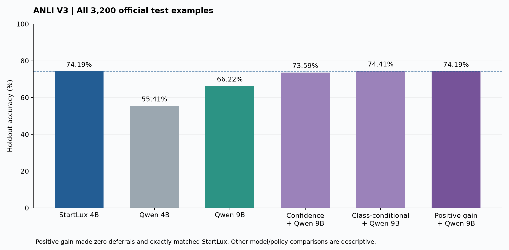
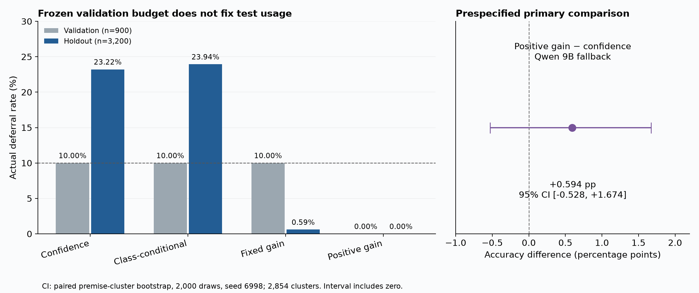

# V3 ANLI 完整结果与独立验收

2026-11-03，America/Los_Angeles。**V3 预定质量实验全部完成，无需补跑。**
17,700 条正式预测、六组完成收据、政策冻结、首次标签访问和最终评价全部通过独立核验。
Qwen9B 已在单张 L40S 上以 BF16 顺序完成两阶段采集。主政策相对 confidence 的准确率
差为 **+0.594 个百分点，95% CI [−0.528, +1.674]**，尚未证明改善。

主政策在验证集就冻结为不转交，holdout 的离线路由也未选用后级预测，因此准确率等于
直接 StartLux。为完成对照，本轮仍完整采集了两种 Qwen 的输出。零转交描述的是政策
回放行为，不能称为成功识别了后级可救回的样本，也不代表实际采集没有消耗后级算力。

## 完成范围与身份

- 原始返回包 SHA256：`a8d0dc672d83c3edcb85d005e66fa4b3d000132729f98f0beaab6865dfc57a9e`。
- ZIP 14,454,072 字节，819 个安全唯一成员；818 份清单文件的大小和 SHA 全部一致。
  原包保存在 [不可变归档](../../records/bundles/v3-return-20261103-232529-a8d0dc672d83.zip)。
- 三模型各 fit 2,700、holdout 3,200，共 17,700 条正式预测 / 708 分片；开发 smoke
  另 1,080 条。18,780 次调用零失败、零重试，request ID 全局唯一。
- 六组原响应重解析、逐行任务/输入/revision/config、token 覆盖与无截断、分片 SHA、
  smoke、completion 全部通过。smoke 是同模型重复采集；Qwen 只验证预测标签一致，
  没有概率向量可逐值比较，也不是独立模型正确性参照。
- 四份准备数据与原发布逐字节一致；holdout 为全部 3,200 道官方 ANLI test、2,854 个
  规范化 premise 组，其中一个组跨 round。原发布 25 个新文件与 22 个依赖身份通过。
- 六模型任务按预定单模型顺序执行。fit 最后完成 22:47:45 UTC → freeze 22:47:59 →
  holdout 最后完成 23:24:57 → 首次标签访问 23:25:24 → 评价及导出 23:25:29。
  这是文件与程序所记录的访问顺序，不是对外部人工访问的技术隔离证明。

## 直接模型结果

指标是 ANLI entailment / neutral / contradiction 三分类准确率。

| 模型 | 正确 / 3,200 | 总准确率 | R1（1,000） | R2（1,000） | R3（1,200） |
|---|---:|---:|---:|---:|---:|
| StartLux 4B | 2,374 | **74.188%** | 82.60% | 72.70% | 68.42% |
| Qwen 4B | 1,773 | 55.406% | 64.80% | 53.90% | 48.83% |
| Qwen 9B | 2,119 | 66.219% | 73.10% | 65.10% | 61.42% |

Qwen9B 比同系列 4B 高 10.813 个百分点，但仍比 StartLux 低 7.969 个百分点。这是本次
冻结任务、提示与无 thinking 配置下的描述性比较，不代表模型通用能力排序。

## 所有冻结政策

前级均为 StartLux；目标预算均为 validation 上限 10%。实际 holdout 预算由冻结阈值产生，
没有在 test 上重新取 top-k，也没有为使预算相等而重新调阈值。救回/误伤相对直接 StartLux。

| 后级 | 政策 | 正确数 | 准确率 | 实际转交 | 转交率 | 救回 | 误伤 | 净增正确 |
|---|---|---:|---:|---:|---:|---:|---:|---:|
| 4B | confidence | 2,229 | 69.656% | 743 | 23.219% | 98 | 243 | −145 |
| 4B | class_conditional | 2,273 | 71.031% | 766 | 23.938% | 94 | 195 | −101 |
| 4B | fixed_gain | 2,374 | 74.188% | 29 | 0.906% | 0 | 0 | 0 |
| 4B | positive_gain | 2,374 | 74.188% | 0 | 0% | 0 | 0 | 0 |
| 9B | confidence | 2,355 | 73.594% | 743 | 23.219% | 147 | 166 | −19 |
| 9B | class_conditional | 2,381 | 74.406% | 766 | 23.938% | 164 | 157 | +7 |
| 9B | fixed_gain | 2,374 | 74.188% | 19 | 0.594% | 0 | 0 | 0 |
| 9B | **positive_gain（主候选）** | **2,374** | **74.188%** | **0** | **0%** | **0** | **0** | **0** |

唯一预定主比较为 9B 后级的 positive_gain − confidence。按 premise 配对重采样 2,000 次，
seed 6998，计算 pooled question-weighted accuracy difference；完整复现差值 +0.59375pp、
区间 [−0.527672,+1.674124]pp。区间跨零，不证明优于对照，也不证明二者等价。它比较的是
两套预先冻结、可在线应用的政策在离线评估中的结果，不能包装成测试阶段相同计算预算
下的公平成本比较，也未测量实际执行该级联时的系统开销。

两种 positive_gain 在 validation 都没有正收益分数候选，冻结 `mode=none`；本次全部
calibration、validation、holdout 的拟合 gain score 也均为负。零转交是冻结政策在离线
回放中的决策结果，所有后级预测均已完整采集。相对 confidence 的 +19 题来自避免其净误伤；相对直接
StartLux 没有增加正确题。9B class_conditional 的 +7 题仅为次要描述，不能替换主结论。

## 验证预算没有在测试集保持

| 模型 | Calibration（1,800） | Validation（900） | Holdout（3,200） |
|---|---:|---:|---:|
| StartLux 4B | 91.444% | 90.556% | 74.188% |
| Qwen 4B | 79.611% | 78.333% | 55.406% |
| Qwen 9B | 85.056% | 83.111% | 66.219% |

上述是不同样本集之间的描述。calibration/validation 来自经过 premise 隔离的官方 train，
holdout 来自官方 test；不能将差异解释为同一批问题上的性能退化或某一个已识别的原因。

StartLux 最大概率中位数从 validation 的 0.9520 降至 holdout 的 0.8131，平均值从
0.8824 降至 0.7777；输入 state 字符数中位数为 397→402。confidence 的同一阈值把
90/900=10% 变成 743/3,200=23.219%，class_conditional 变为 23.938%。因此 nominal
validation budget 不能当成此次 test 的实际转交保证。长度中位数相近并不能排除语义、
类别、采样或训练暴露方面的差异；当前结果没有识别这些原因。

## 仍存在互补性，但本次 gain 政策没有利用

| 后级 | 双方都对 | 双方都错 | 前级对、后级错 | 前级错、后级对 | 标签 oracle 的并集准确率 |
|---|---:|---:|---:|---:|---:|
| Qwen 4B | 1,567 | 620 | 807 | 206 | 80.625% |
| Qwen 9B | 1,830 | 537 | 544 | 289 | 83.219% |

9B 有 289 题能救回前级错误，同时有 544 题会把前级的正确答案改错。Oracle 是事后用真值
挑选正确模型的上界，不是可部署政策，也不证明现有特征能识别这些题。本次可支持的结论
是低容量 gain 拟合与固定特征没有产生正收益转交；不能扩大成“所有路由均无潜力”。

## 运行与复现边界

- 本次 host `sc1ns051is14`、Slurm job `65577162`；记录的设备为 L40S 46,068 MiB、
  driver 580.126.09，vLLM 0.31.0、BF16。包没有 GPU UUID 或 Slurm MaxRSS，不能据此
  判断主机 RAM 峰值或是否仍有活跃 allocation。
- Qwen9B 固定 revision `c202236235762e1c871ad0ccb60c8ee5ba337b9a`，两次加载并完成
  采集；引擎报告模型加载占用 16.8 GiB。这是加载阶段报告，包含 KV cache、激活等的
  总运行显存不能用该数字替代。模型单独驻留 memory fraction 0.8，尚未验证与前级同驻留。
- 初始化到最终导出约 71 分 55 秒（14:13:34→15:25:29 PST），包含预检、加载、smoke、
  采集和评价。21 份日志未见 OOM 或 shutdown 前 ERROR；四份引擎日志的 EngineDeadError
  均发生在主动关闭之后。六个预算 session 均正常关闭，最后服务停止早于首次标签访问。
- StartLux health 元数据将 prefix_cache 报为 true，但启动命令和两份引擎启动日志均明确
  禁用 prefix caching。保留这项元数据不一致，以实际启动配置核对；不能声称所有报告
  字段完全一致，也没有改写原健康响应。
- 单请求串行采集平均时延约 StartLux 38.64ms、Qwen4B 129.71ms、Qwen9B 267.99ms。
  它们不是并发吞吐、SLO goodput 或同驻留级联系统性能。
- 本机 NumPy 2.5.4 重新拟合 freeze 时有 65 处浮点差，最大 8.88e−16；全部 validation
  指标和 fit/holdout 路由决策一致。原 freeze 及其 hash 保留不变，统计复算应用原冻结参数。
- 独立统计脚本未导入项目评分/路由/存储函数，直接核对三模型、八政策、全部 round、
  互补性与主 bootstrap，和原 evaluation 完全一致。此前 91 份受索引保护的报告/审计/
  V3 准备文件及历史回传归档保持不变。

## 后续处理

本轮 GPU 质量实验可收尾。现有 V1/V2/V3 足以先组织一条清晰的报告线索：后级更大未必在
目标任务上更强、允许不转交能避免强制使用弱后级、validation 阈值的实际预算会随数据变化。
后两项须按各自观测和不确定性表述，不把零转交写成通用最优策略。

建议先收敛源码仓库并将 V2/V3 纳入结果报告和 CPU Lab。若再做实验，预算迁移与互补性
识别是有证据支撑的候选问题；需要另立协议和未用于选方案的评价数据。本次 ANLI test
已经查看，不能继续在它上面挑特征/阈值后宣称新的验证性收益。

## 可复核材料

- [原回传 evaluation](../../results/returned-v3-2026-11-03-152529/evaluation.json)
- [政策冻结](../../results/returned-v3-2026-11-03-152529/policy_freeze.json)
- [归档与发布核验](../../.validation/v3-complete-2026-11-03-152529/archive-audit.json)
- [身份与冻结复拟合](../../.validation/v3-complete-2026-11-03-152529/identity-audit.json)
- [独立统计复算](../../.validation/v3-complete-2026-11-03-152529/statistics-audit.json)
- [运行日志审计](../../.validation/v3-complete-2026-11-03-152529/runtime-audit.json)
- [直接模型 CSV](../../.validation/v3-complete-2026-11-03-152529/direct-metrics.csv)
- [政策 CSV](../../.validation/v3-complete-2026-11-03-152529/policy-metrics.csv)
- [分数据集 CSV](../../.validation/v3-complete-2026-11-03-152529/split-direct-metrics.csv)
- [Bootstrap draws](../../.validation/v3-complete-2026-11-03-152529/primary-bootstrap-draws.csv)
- [图表数据](chart_data.json)，图另有 PDF 版本。
